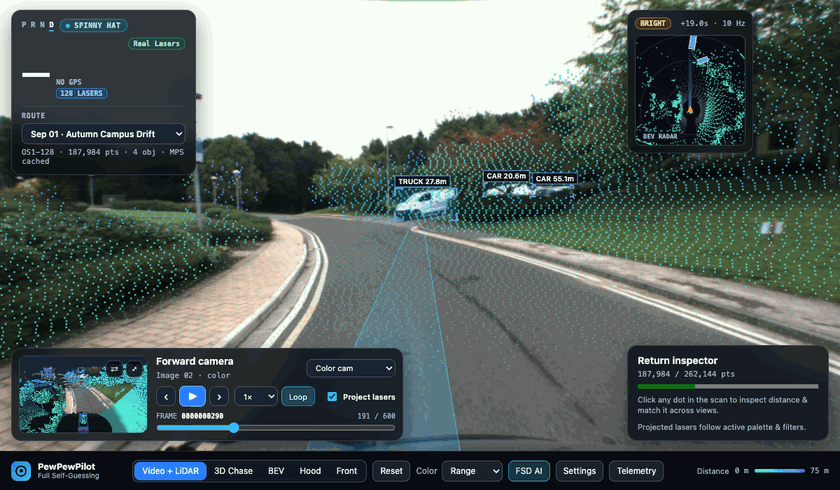
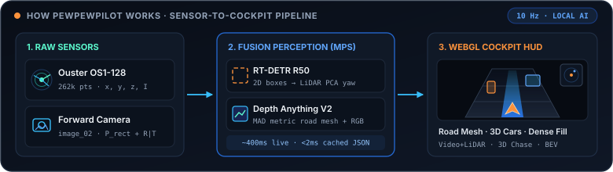

# PewPewPilot · Full Self-Guessing

Interactive autonomous-cockpit sensor viewer for **128-channel Ouster LiDAR**, calibrated stereo cameras, and **local Apple Silicon CoreML perception**, powered by a **Rust (`axum` + `ort`) backend**. Compare the live forward camera (with LiDAR projection, AR drive path, and 2D detection brackets) alongside real-time 3D WebGL geometry rendered from **RT-DETR** + **Depth Anything V2** fused with raw laser returns.

<p align="center">
  
</p>

<p align="center">
  
</p>

## How it works

1. **Rust Sensor Streaming ([`src/loader.rs`](src/loader.rs), [`src/main.rs`](src/main.rs))**: Zero-overhead `axum` API streaming 262k-point OS1-128 LiDAR frames (`[x, y, z, intensity]`), forward camera images (`image_02` / `image_01`), LiDAR panoramic modalities (`ambient` / `reflec`), and GPS/IMU/Lux telemetry using calibrated `P_rect` + `R|T` extrinsics.
2. **CoreML ONNX Runtime + Native Rust 3D Fusion ([`src/perception.rs`](src/perception.rs))**: Executes `Depth-Anything-V2-Small-hf` and `PekingU/rtdetr_r50vd` via `ort` (CoreML Execution Provider on Apple Neural Engine / Metal GPU), aligns affine depth to metric LiDAR returns via 2-stage MAD-trimmed least squares, pairs 2D detections with clustered LiDAR PCA heading angles, and caches JSON geometry (`road_mesh`, `dense_points`, `objects`) under `data/<sequence>/perception/` (`< 0.5 ms` once cached).
3. **WebGL Cockpit HUD ([`static/point-cloud.js`](static/point-cloud.js), [`static/viewer.js`](static/viewer.js))**: Combines full-bleed `Video + LiDAR` overlay with an expandable `3D Chase` / `BEV Radar` PIP, smooth shaded 3D terrain mesh, oriented 3D cars/pedestrians/signs, and dense foreground RGB completion.

## Start the viewer

Build and launch the Rust server (requires [Rust](https://rustup.rs)):

```sh
# Optional: export ONNX weights once for live uncached FSD AI perception on CoreML/CPU
python3 -m pip install torch transformers onnx
python3 export_onnx_models.py

./run_viewer.sh
```

Open [http://127.0.0.1:8000](http://127.0.0.1:8000). Pass a port argument (`./run_viewer.sh 8080`) or run `cargo run --release -- --port 8080` directly. If the synthetic sample is missing, run `python3 generate_sample_data.py` and reload.

To export the synthetic or recorded sequence into a standalone single-file browser bundle without running a server:

```sh
python3 export_sample_viewer.py pewpewpilot-viewer.html
```

## Cockpit controls

| Control | What it does |
| --- | --- |
| **Video + LiDAR** | Full-screen forward camera with calibrated LiDAR overlay, AR blue drive path, and corner detection brackets (3D Chase stays live in the PIP). |
| **3D Chase**, **BEV**, **Hood**, **Front** | Orbit in low chase perspective behind the ego vehicle, top-down Bird’s-Eye View radar, LiDAR hood origin, or front-facing lookback. |
| **FSD AI** | Toggle local CoreML perception (`3D objects`, smooth `3D road mesh`, and `dense depth fill`). Open Settings → **Precompute 60f** to pre-cache frames ahead for 10 Hz playback. |
| **Project lasers** | Overlay filtered LiDAR returns onto the camera frame using sequence calibration and active color palette. |
| **Return inspector** | Click any point in the 3D scan or camera overlay to measure metric `Range`, `Forward`, `Left`, `Height`, and `Intensity` across views. |
| **360° Ambient / Reflectivity** | Switch the camera feed to the roof LiDAR’s panoramic ambient light or surface reflectivity images. |
| **Playback** | Space to play/pause (`0.5×–5×`, `1×` target = 10 Hz), arrow keys or timeline scrubber to step frames. |

Measurements use LiDAR coordinates where positive forward, left, and height correspond to `+x`, `+y`, and `+z`.

## View recorded DurLAR drives

Download 12 paired frames from the first [DurLAR_S exemplar drive](https://huggingface.co/datasets/l1997i/DurLAR_S) or export a standalone offline bundle:

```sh
python3 -m pip install huggingface_hub
python3 download_durlar.py --exemplar-only --frames 12
python3 export_sample_viewer.py durlar-recorded.html --sequence data/DurLAR_20210716_S
```

Or download all paired LiDAR and image frames from every exemplar drive under `data/`:

```sh
python3 download_durlar.py --all-drives --all-frames
```

Rerun to resume cleanly (`--all-drives --frames 12` pulls short clips). Camera projection uses the [authors' calibration](https://github.com/l1997i/DurLAR/blob/main/DurLAR_calibs.zip).

Source dataset: *DurLAR: A High-fidelity 128-channel LiDAR Dataset with Panoramic Ambient and Reflectivity Imagery for Multi-modal Autonomous Driving Applications*, Li Li, Khalid N. Ismail, Hubert P. H. Shum, and Toby P. Breckon, 3D Vision, 2021. [Paper](https://arxiv.org/abs/2406.10068).

## Load another sequence

Place an extracted sequence directly under `data/` keeping sensor folders and calibration files together. The server expects little-endian `[x, y, z, intensity]` float32 point records plus LiDAR-to-camera extrinsics and camera projection matrices for image overlays.

See the [DurLAR dataset](https://huggingface.co/datasets/l1997i/DurLAR) and `python3 download_durlar.py --help` for dataset options.

## Railway deployment

See [Railway setup](RAILWAY.md) for hosting a read-only single-drive Rust instance on Railway Hobby.
